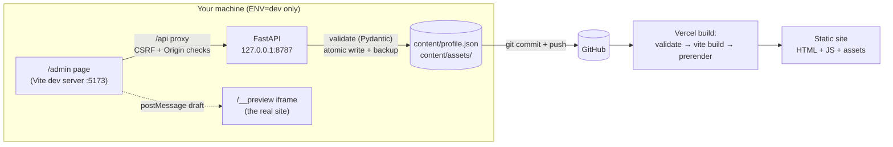

# Aravind Russell V — Portfolio

A fast, static portfolio for a Test Automation Architect. Every word on the site comes from
**one file**, `content/profile.json`, which you edit through a **local-only admin page**.
Vercel serves the public site as static files: no backend, no database, nothing to patch.

- **Public site:** React 19 + TypeScript + Vite, Tailwind CSS 4, Framer Motion. Prerendered to
  static HTML at build time (readable without JavaScript, LCP under 1 s).
- **Admin + API:** Python FastAPI + Pydantic, bound to `127.0.0.1`. It exists only in the dev
  environment and is never built or deployed.
- **Quality:** pytest (79 tests), Playwright with Page Object Model (71 tests incl. axe), ruff,
  mypy `--strict`, ESLint `strict-type-checked`, Prettier, Lighthouse CI (≥ 95 asserted).

## Architecture



```
models.py (Pydantic) ──gen_schema.py──▶ profile.schema.json ──gen-types.mjs──▶ src/types/profile.ts
       │                                       │
       └─ API validation on save               └─ ajv: live admin validation + build gate
```

The **Pydantic models are the single source of truth**. The JSON Schema and the TypeScript
types are generated from them, and `npm run check:types` fails if either is stale.

### Why the admin can't leak into production

| Layer | Guard |
| --- | --- |
| Bundle | The admin is lazy-imported only inside `if (import.meta.env.DEV)`, so Rollup removes it. A Playwright test checks that the built JS contains no `/api/` or admin code and that `/admin` returns 404. |
| Process | The API refuses to start unless `ENV=dev`, and `app.serve` always binds to `127.0.0.1`. |
| Network | Middleware rejects non-loopback clients, unexpected `Host` headers (DNS rebinding) and `Origin` headers, and cross-site `Sec-Fetch-Site`. |
| Writes | A double-submit CSRF token (SameSite=Strict, HttpOnly cookie plus `X-CSRF-Token` header) and an `Origin` header are required. |
| Data | Pydantic with `extra="forbid"`, length, URL, date and colour constraints, and cross-field rules. |
| Uploads | Type is sniffed from magic bytes (not the header), 5 MB image / 10 MB PDF limits enforced before parsing, images re-encoded to WebP (strips EXIF and payloads, SVG rejected), PDFs with JavaScript, actions or embedded files rejected, slugified and hashed filenames. |
| Storage | Atomic writes (temp file → fsync → rename), a timestamped backup before every save (last 30 kept), and undo. |

## Folder structure

```
backend/            FastAPI app (dev only)
  app/              models, security, storage, uploads, git_status, main, serve
  tests/            pytest: validation, localhost/CSRF rules, backups, uploads
content/
  profile.json      ← all site content (edit via /admin)
  profile.schema.json   generated from backend/app/models.py
  assets/           images, OG image, uploaded resume PDF
  backups/          automatic backups (git-ignored)
frontend/
  src/site/         public site (sections, components)
  src/admin/        admin editor (dev only)
  src/lib/          content, SEO, colour, date and font helpers
  plugins/          Vite plugin: head tags, fonts, assets, sitemap, robots
  scripts/          validate-content, prerender, gen-types
  e2e/              Playwright: pages/, components/, fixtures/, tests/{public,admin}
scripts/            setup, dev runner, schema + image generators
vercel.json         build settings + security headers
```

## Setup

Prerequisites: **Node 20+**, **Python 3.12+**, Git. [`uv`](https://docs.astral.sh/uv/) is
used if installed; otherwise setup falls back to `venv` + pip.

```bash
npm run setup        # creates backend/.venv, installs Python + npm dependencies
cp .env.example .env # optional: VITE_FORMSPREE_ID, VITE_SITE_URL
npx --prefix frontend playwright install chromium   # once, for e2e tests
```

`make` targets mirror the npm scripts (`make dev`, `make test`, …) where `make` is
available. On Windows without `make`, use the npm scripts or `scripts/dev.ps1`.

## Run

```bash
npm run dev
```

| URL | What |
| --- | --- |
| http://localhost:5173 | The site, with hot reload |
| http://localhost:5173/admin | Content editor |
| http://127.0.0.1:8787/api/health | API health check |

## Editing content

1. Open **/admin**. Each tab edits one part of `profile.json`. You can add, edit, delete,
   drag to reorder (or focus the ⠿ handle and use Space + arrow keys, or use ↑/↓), and
   show/hide items and whole sections.
2. The **live preview** on the right is the real site rendering your draft. Switch between
   Mobile, Tablet and Desktop widths.
3. Errors show inline as you type. Rules that span several fields (date order, alt text,
   unique ids) are checked on save.
4. **Save** (or Ctrl+S) writes `content/profile.json` and keeps a backup.
   **Undo last save** restores the newest backup. Undo is itself undoable.
5. **Import / Export JSON** for bulk edits. Imports are validated before they're loaded.
6. Open the **Publish** tab: it shows the git status of `content/` and the commands to run:

```bash
npm run check                               # lint, types, schema freshness, API tests, build
git add content
git commit -m "content: update portfolio"
git push                                    # Vercel redeploys automatically
```

**Resume button:** set *Profile → Resume* to a link (currently the OneDrive PDF) or upload a
PDF, which is then served from `/content/assets/…pdf`.

**Contact form:** set `VITE_FORMSPREE_ID` (locally in `.env`, on Vercel as an environment
variable). Without it, the Contact section shows email, LinkedIn and GitHub buttons instead.

**Changing the schema:** edit `backend/app/models.py`, then run `npm run gen:types`.

**Regenerating the OG image and touch icon** after a name or accent change:
`node scripts/py.mjs ../scripts/make_images.py`.

## Build and preview

```bash
npm run build      # validate content → vite build → SSR prerender → frontend/dist
npm run preview    # serves the build at http://localhost:4173 (404s like Vercel)
```

## Tests

```bash
npm run test:api     # pytest
npm run test:e2e     # Playwright: builds + previews the site, starts an isolated admin stack
npm run lighthouse   # Lighthouse CI, asserts ≥ 0.95 in all four categories (mobile)
npm run lint && npm run typecheck
```

The Playwright suite uses the **Page Object Model**:

- `e2e/pages/`: `HomePage`, `AdminPage` (extending `BasePage`)
- `e2e/components/`: `NavBar`, `SortableListEditor`, `PreviewFrame`
- `e2e/fixtures/`: a custom `test` that injects page objects, an axe builder and a
  `ContentStore` for arranging and asserting on the content file
- `e2e/tests/public`: runs against the **production build** (desktop and Pixel 7)
- `e2e/tests/admin`: runs against an isolated stack (ports 5174/8788) using a throwaway copy
  of `content/`, reset before every test. Your real `profile.json` is never touched.

## Deploy to Vercel

1. Push this repo to GitHub and **Import Project** in Vercel. Keep the root directory as the
   repo root.
2. `vercel.json` already sets the install command (`npm --prefix frontend ci`), the build
   command (`npm --prefix frontend run build`) and the output (`frontend/dist`), plus
   security headers (CSP, HSTS, nosniff, Referrer-Policy, Permissions-Policy) and caching.
3. Environment variables (optional): `VITE_SITE_URL` (e.g. `https://your-domain`) and
   `VITE_FORMSPREE_ID`.
4. Each push to `main` redeploys. If `profile.json` is invalid, the build fails and the
   current site stays live.

To reuse your existing `aravindrusselportfolio.vercel.app`, connect this repo to that Vercel
project instead of creating a new one.

## Environment variables

| Variable | Where | Purpose |
| --- | --- | --- |
| `VITE_SITE_URL` | build | Canonical, OG and sitemap URLs (falls back to `seo.siteUrl`) |
| `VITE_FORMSPREE_ID` | build | Enables the contact form |
| `ENV` | API | Must be `dev` or the API refuses to start |
| `API_PORT` / `WEB_PORT` | dev | Default 8787 / 5173 |
| `CONTENT_DIR` | dev/tests | Point the API and Vite at another content folder |

No secrets are needed or committed. `.env` is git-ignored.
